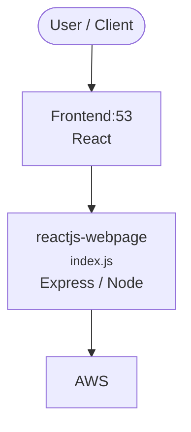

# Context Map — `reactjs-webpage`

> Auto-generated architecture & deployment context map. Summarizes the core application, container/cloud footprint, and database connections. Regenerate after significant structural changes.

**Repo:** `avnit/reactjs-webpage` · **Original** · Public · Primary language: JavaScript · Default branch: `master` · Files: 172

## 1. Core application

reactjs-webpage

- **Frameworks / runtime:** Express / Node, React
- **Entry points:** `material-kit-react-master/src/index.js`
- **Listens on port(s):** 53

## 2. Containers & cloud applications

**Detected cloud platforms / services:** AWS

## 3. Database connections

_No database drivers or connection strings detected._

## 4. Architecture diagram

## 5. Security posture

- **Dependabot alerts (open):** 1 medium

---
_Generated by repo context-mapping pass on 2026-08-13._